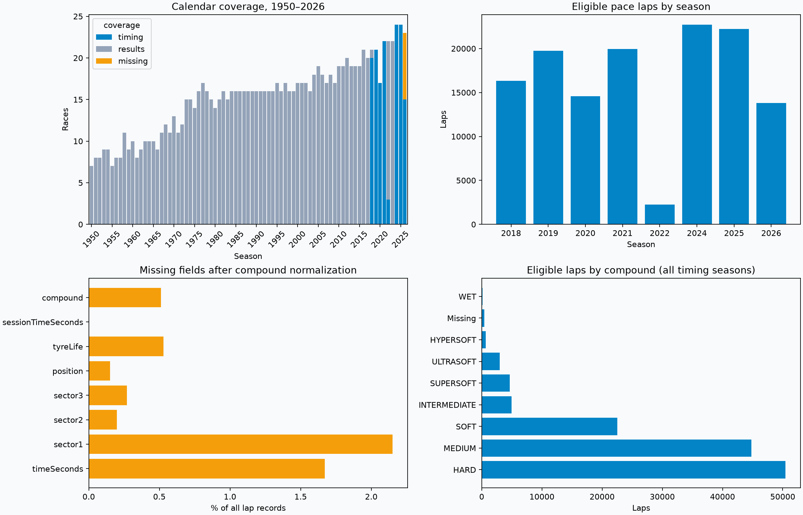
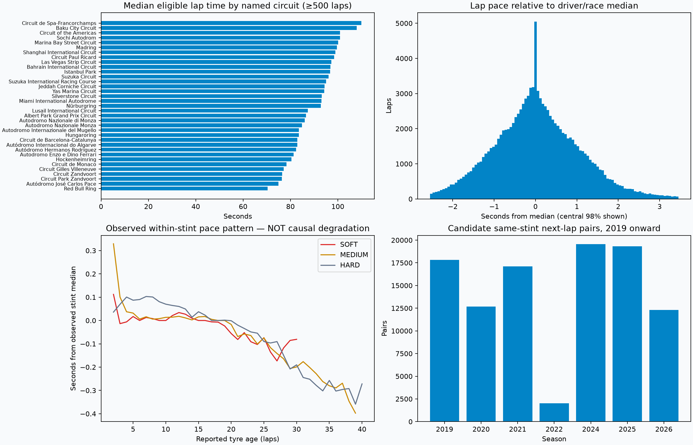

# Pitwall Lab — exploratory data analysis

Generated 2026-10-01T14:49:47.345104+00:00. Offline audit of calendar-linked local snapshots. No upstream downloads or source-data changes.

## Dataset inventory

- 77 seasons; 1,172 calendar entries; 1,164 recorded snapshots.
- 146 timing races; 160,711 laps; 131,596 eligible laps (81.9%).
- 26,203 driver result entries; 8,023 observed tyre segments.
- 21,172 weather observations; 34 timing races report rainfall at least once. Missing rainfall was exported as false, so this does not establish all other races were dry.

## Timing coverage by season

| season | laps | eligible | stints | timing | results | missing |
| --- | --- | --- | --- | --- | --- | --- |
| 2018 | 21410 | 16331 | 1156 | 20 | 1 | 0 |
| 2019 | 23676 | 19737 | 1065 | 21 | 0 | 0 |
| 2020 | 18350 | 14584 | 924 | 17 | 0 | 0 |
| 2021 | 23756 | 19956 | 1223 | 22 | 0 | 0 |
| 2022 | 2990 | 2236 | 157 | 3 | 19 | 0 |
| 2023 | 0 | 0 | 0 | 0 | 22 | 0 |
| 2024 | 26604 | 22719 | 1289 | 24 | 0 | 0 |
| 2025 | 26689 | 22242 | 1299 | 24 | 0 | 0 |
| 2026 | 17236 | 13791 | 910 | 15 | 0 | 8 |

Earlier seasons have classification-only coverage. Missing timing is not random: 2022–2023 are incomplete and 2018 has a known failed import. Results-only snapshots have intentionally empty timing arrays.

## Data quality

| field | all_missing | eligible_missing | all_missing_pct |
| --- | --- | --- | --- |
| timeSeconds | 2688 | 0 | 1.67 |
| sector1 | 3449 | 0 | 2.15 |
| sector2 | 328 | 0 | 0.2 |
| sector3 | 432 | 0 | 0.27 |
| position | 239 | 0 | 0.15 |
| tyreLife | 852 | 485 | 0.53 |
| sessionTimeSeconds | 0 | 0 | 0.0 |
| compound | 821 | 409 | 0.51 |

- Compound placeholders are normalized only in this analysis: null, `nan`, `None`, `UNKNOWN`, and empty strings become missing. Original snapshots remain unchanged.
- Eligibility mismatches against the exporter's rules: **0**. Duplicate race/driver/lap keys: **0**. Nonpositive recorded lap times: **0**.
- Among 131,596 eligible laps with all sectors, **0** have sector sums differing from lap time by more than 20 ms. This threshold is an audit flag, not an automatic deletion rule.
- Quality flags (overlap; do not sum): `{"pitIn": 5103, "pitOut": 5004, "deleted": 1291, "generated": 239, "accurate": 137709}`.
- Weather missing numeric counts: `{"timeSeconds": 0, "airTemp": 0, "trackTemp": 0, "humidity": 0, "windSpeed": 0}`. Numeric completeness does not prove sensor accuracy or correct temporal alignment.
- Missing measurements are not zero. Generated laps, pit laps, deleted laps and non-green laps are excluded from pace summaries.

## Pace and tyre observations

Lap times depend strongly on circuit, so absolute lap times should not be pooled as if directly comparable. The delta chart subtracts each driver's full-race median using eligible SOFT/MEDIUM/HARD laps. This is descriptive hindsight normalization, not an allowed forecasting input.

The tyre-age plot subtracts each observed driver/race/stint/compound median. It pools 2019 onward, shows ages 1–40 only, and requires at least 100 samples per plotted compound/age. It is not a causal degradation curve: fuel burn, traffic, changing track conditions, stint selection and different circuit mixes remain confounders. SOFT/MEDIUM/HARD are weekend-relative categories; underlying physical compounds are not recorded. Green-flag laps on those compounds can still occur in changing weather.

## ML-ready starting pool

- 109,694 eligible laps from 2019 onward with SOFT/MEDIUM/HARD and known tyre age.
- **100,818 candidate adjacent next-lap pairs**, with eligible current/next laps, consecutive lap numbers, unchanged compound/stint and known current tyre age. This is a retrospective target cohort, not a promise that future conditions are known at inference time.

| season | pairs | races | last_lap_MAE_seconds |
| --- | --- | --- | --- |
| 2019 | 17822 | 21 | 0.501 |
| 2020 | 12690 | 16 | 0.505 |
| 2021 | 17107 | 20 | 0.484 |
| 2022 | 2025 | 3 | 0.435 |
| 2024 | 19552 | 23 | 0.431 |
| 2025 | 19310 | 24 | 0.361 |
| 2026 | 12312 | 15 | 0.456 |

The last-lap baseline predicts the next lap using the current lap's recorded time. Its per-season MAE above is exploratory, measured on this retrospectively filtered cohort without any fitted parameters. It is not a trained-model result or a score covering pit stops, flags and all race laps. It establishes the simple predictor a model needs to beat under the same evaluation conditions.

These are correlated observations from a limited number of races. Use chronological whole-race splits, never a random lap split. Missing 2023 timing creates a gap in the proposed training chronology. Report pair coverage separately from prediction error; this cohort excludes interruptions and pit transitions.

## Recommended next experiment

1. Start with a conditional next-lap pace forecast: remaining in the same stint under green conditions.
2. Benchmark last eligible lap and a trailing three-lap median before training a regressor.
3. Build rolling features using only earlier/current laps; align weather backward to the end-of-current-lap prediction cutoff. Full-race medians, final results, future weather and stint end laps must never become inputs.
4. Train on available 2019–2022 timing, validate on 2024, reserve 2025 for testing and use 2026 as a separate forward check. Also report per-race, per-compound and per-circuit errors.
5. Inspect rare circuits, long tyre ages and wet conditions separately. Do not extrapolate a dry pace model into strategy claims without a validated simulator.

## Reproduce

Run `.venv/bin/python scripts/eda.py --check`, then `.venv/bin/python scripts/eda.py`. Outputs are this report, two PNG figures and `summary.json`. pandas and matplotlib are available through the existing FastF1 environment; no new dependency is needed. This is an exploratory audit, not full snapshot schema validation or a trained model.
