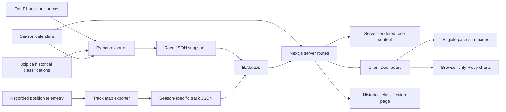

# Architecture and code map

[Back to README](../README.md)

## Data flow



Python runs offline to prepare data. Next.js reads included files on the server and passes the race and calendar to the dashboard. Visitors do not trigger upstream downloads. There is no database, custom API service, background worker or authentication.

## File responsibilities

Driver pages live in `app/drivers/page.tsx` and `app/drivers/[code]/page.tsx`, styled by `app/drivers/drivers.module.css`. `lib/drivers.ts` aggregates only the included race snapshots for the selected season; `components/DriverTrend.tsx` renders a browser-only Plotly finishing-position chart. Both driver routes use season query parameters and server-generated profile content. Driver links are present in the header, race comparison cards and classification tables; profile/season URLs are included in the sitemap.

| Path | Responsibility |
| --- | --- |
| `app/layout.tsx` | Header, local fonts, global metadata and page shell |
| `app/globals.css` | Global tokens, typography, archive and shared styling |
| `app/page.tsx` | Redirect `/` to `/races` |
| `app/races/page.tsx` | Full-season archive from the calendar |
| `app/races/[season]/[slug]/page.tsx` | Slug validation, snapshot loading, static parameters and race metadata |
| `app/races/[season]/[slug]/opengraph-image.tsx` | 1200 × 630 race image using Next ImageResponse |
| `app/about/page.tsx` | User-facing data explanations |
| `app/not-found.tsx` | Not-found screen |
| `app/sitemap.ts`, `app/robots.ts` | Discovery metadata using the public origin |
| `components/HistoricalRace.tsx` | Server-rendered historical classification and provenance |
| `components/SeasonSelect.tsx` | Accessible native year selector for archives and profiles |
| `components/TrackMap.tsx` | Native SVG sectors, recorded/median sector comparisons and synchronized lap control |
| `components/RaceReplay.tsx` | Replay tab: detailed two-driver track view, optional full circuit, observed classification, recorded position-update navigation, timing-point proximity, telemetry, playback and track-status badge |
| `lib/replay.ts` | Pure replay logic: source/estimated checkpoints, speed integration normalized to checkpoints, road-constrained illustrative driver paths, timing-point gaps, geometry and telemetry decoding, track status |
| `lib/replay-timing.ts` | Independent checkpoint validation and last-observed classification lookup; unknown ranks remain null |
| `scripts/export_positions.py` | Replay export: racing line, per-car distance along it, fitted track edges and car telemetry |
| `public/replay/<season>/<slug>.json`, `<slug>.telemetry.json`, `<slug>.timing.json` | Reference geometry, track edges, independent car telemetry and optional source checkpoints/observed ranks, fetched when the Replay tab opens |
| `data/track-surveys/` | Third-party centre lines and track widths (LGPL-3.0) used for track edges |
| `scripts/export_track_maps.py` | Compact telemetry geometry export with bounded requests and optional temporary parser cleanup |
| `data/tracks/<season>/<slug>.json` | Matching season/round circuit geometry and reference-lap provenance |
| `components/Dashboard.tsx` | Views, selections, URL state, chart traces, metrics and tables |
| `components/Dashboard.module.css` | Dashboard styling and responsive rules |
| `components/Plot.tsx` | Plotly basic bundle React wrapper |
| `lib/data.ts` | Types, seasons discovered from imported calendars, filesystem calendar and snapshot loaders |
| `lib/stats.ts` | Median, time formatting and eligible-lap summaries |
| `lib/site.ts` | Public origin resolution |
| `lib/plotly.d.ts` | Declaration for the Plotly bundle |
| `data/<season>/calendar.json` | Ordered season manifest with status/date metadata |
| `data/<season>/<slug>.json` | Prepared race snapshot |
| `scripts/export_races.py` | FastF1 export, caching and snapshot assertions |
| `scripts/check_stats.cjs` | Runnable statistics regression check |
| `public/flags/`, `public/brandmark.png` | Local flag SVGs and raster brandmark |
| `design/reference.png`, `design-qa.md` | Selected option 3 reference and QA record |

## Driver photography

`data/driver-photos.json` maps driver codes to local files, source pages, authors and license URLs. `lib/driver-photos.ts` reads the manifest on the server and supplies its typed entries to pages; a missing/unreadable manifest uses empty entries and photo fallbacks. `components/DriverPhoto.tsx` uses responsive Next Image sizing and a deterministic initial render, then falls back to a driver code/number if a local image fails. Hero images load with priority; directory images load lazily. `/image-credits` renders the manifest attribution without nested links in driver cards. Photo framing and hover animation use existing CSS and respect reduced motion.

## Server and browser boundary

`lib/data.ts` imports Node filesystem modules and must stay on the server. Dashboard imports its types with `import type`; runtime data arrives through props. Preserve this separation when extending the app.

Dashboard is a client component, but Next.js still renders its initial HTML. The initial view is Compare, with the first classified driver versus Sainz when available, otherwise another driver. Query parameters are applied after mounting. A URL requesting a different tab initially receives default race content before the browser applies its selection.

Plotly is dynamically imported with SSR disabled because it needs browser APIs. Initial HTML contains race text and metrics, with a chart loading placeholder. `connectgaps: false` avoids joining missing measurements. Drivers with the same team color use distinct line styles.

## Routes and failures

| URL | Result |
| --- | --- |
| `/` | Redirect to archive |
| `/races` | Latest season archive; `?season=<year>` selects an imported historical or modern season |
| `/races/<season>/<slug>` | Detailed dashboard or historical classification according to coverage |
| `/races/<season>/<slug>/opengraph-image` | Race social image |
| `/about` | Data definitions |
| `/sitemap.xml`, `/robots.txt` | Crawler metadata |

`generateStaticParams()` prerenders calendars from 2018 onward. Earlier historical pages render on demand, avoiding a full-history static build. All imported race and driver URLs remain in the sitemap. Unknown seasons or slugs call `notFound()`. An upcoming entry renders its schedule without estimated results. A known completed entry with an unreadable/missing snapshot renders “Data unavailable.” `loadRace()` catches read/JSON errors and returns null; it does not validate the full schema at runtime. Validate snapshot changes before deployment.

## Dashboard URL state

```text
/races/2024/bahrain?tab=compare&a=VER&b=SAI&start=11&end=20&lap=15
```

| Parameter | Behavior |
| --- | --- |
| `tab` | overview, pace, strategy, compare, track or replay; invalid/absent uses compare |
| `a`, `b` | Race driver codes; unknown/duplicate selections use fallback drivers |
| `start`, `end` | Inclusive bounds; finite integers clamp to race distance; invalid/reversed ranges use full race |
| `lap` | Integer within selected range; otherwise no selected lap |

Controls use `history.replaceState()`, so every adjustment does not create a new history entry. A popstate listener reloads query state on history navigation. Race selection uses Next's router and a clean race URL. The eligible checkbox and selected stint details are local state, absent from shared URLs.

Pace and Compare share the main chart and metrics; Compare additionally exposes sectors and consistency. Tyre rows show the whole race even when metrics use a narrower range. Classification is visible on Overview and expandable on other views.

## SEO and hosting

`lib/site.ts` uses `NEXT_PUBLIC_SITE_URL`, then `VERCEL_PROJECT_PRODUCTION_URL`, then localhost. Race metadata includes a title, description, canonical route and social image. Canonicals exclude comparison queries. Sitemap, archive and static routes share one calendar.

The app uses Next server functionality: filesystem loading, redirects, image optimization and image responses. It is not configured as a standalone static HTML export.

### Replay race view

`tab=replay` renders `RaceReplay` for detailed timing races with a matching track layout. `loadRace()` independently detects geometry, telemetry and timing sidecar assets. The component validates matching sessions and fetches each available asset separately, waiting for all requests to settle before playback; requests abort on race changes and after a 20-second limit. Geometry supplies the course and surveyed road only, never per-car animation distance. Source checkpoint timestamps anchor movement where available; other races use explicitly estimated lap/sector checkpoints. Speed integration is normalized between anchors, with timing-based movement for missing telemetry intervals. Recorded speed readouts are independent of that visual normalization.

The default detailed track view runs at 1× and follows the selected pair. Distinct paths are stable per driver and constrained inside available road edges. Cars, headings, trails, camera and minimap all use `driverPointAt()` on the same driver path. Trails use unwrapped progress and history clamped to the driver's start, preserving continuity across lap boundaries. Existing kerbs, survey edges, sector lines, car bodies and brake lights remain. The optional full-circuit view shows the field. Motion/path geometry are memoized; animation frames paint SVG positions directly while panel readouts publish at 125 ms. Playback pauses when hidden and discards long frame delays; seeking does not start playback.

For the Monza pilot, classification holds the last timing-stream observation and is unknown before the first observation. Other races show unknown recorded ranks. Position-update navigation seeks to observed rank changes for the selected pair without inferring a passer, passed driver or physical passing instant. Timing-point gaps and proximity remain separately identified. Geometry/telemetry/timing failures show explicit fallback notices. Poorly fitting reference lines can use a constrained survey-midpoint path; if neither path is safe, cars become unavailable while track details remain visible. [Replay data and accuracy](data.md#exact-timing-and-observed-classification-pilot).

### Track race view

Detailed dashboards and historical results expose a URL-backed `tab=track` view. `TrackDetails` renders on the server and passes through a React slot, keeping filesystem reads out of client components. It matches normalized circuit names across imported calendars, rather than Grand Prix names, and displays completed-race history, winner grids, archive span and wins from pole. Name changes may omit matching venues; configurations may differ. The session fastest eligible lap is not an official circuit record. The existing TrackMap retains season-specific geometry and missing-data behavior.
